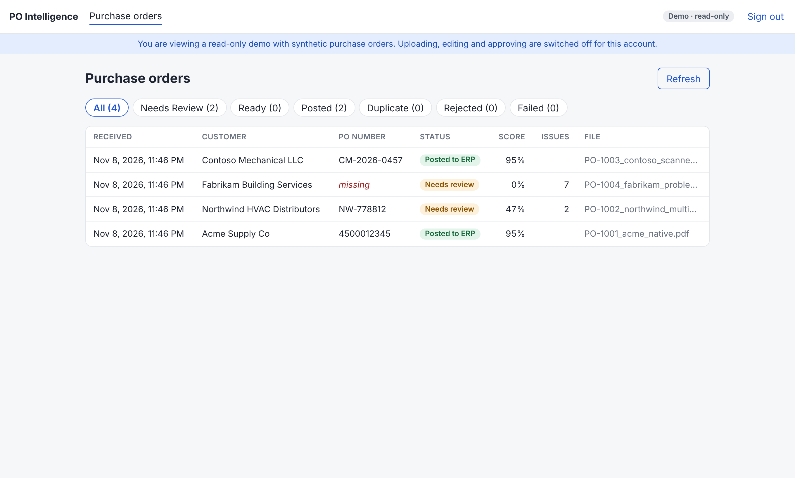
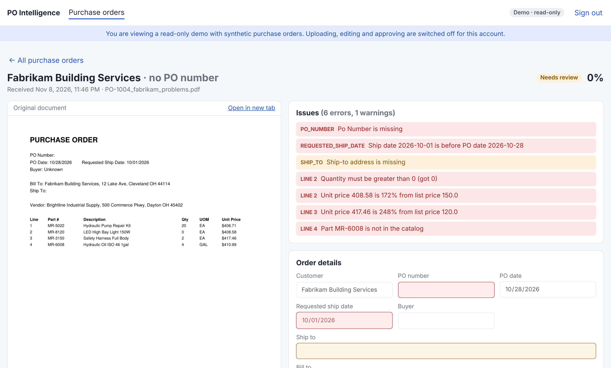
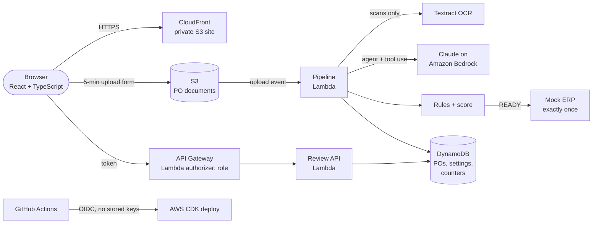

# PO Intelligence

**AI purchase-order processing on AWS, built end to end as a personal learning project.**
A PDF or scanned purchase order goes in; a validated sales order comes out, or a clear list of what a person needs to check.

[](https://github.com/saratcsk/po-intelligence/actions/workflows/ci.yml)

**Live demo (read-only):** https://po.saratsasikumar.com → click **Explore the read-only demo**

> [!IMPORTANT]
> **Educational project only.** Built in my own time to learn and demonstrate cloud, AI and delivery practices.
> It is not a product, is not offered for sale or as a service, and has no customers or users.
> All purchase orders, companies, parts and prices are synthetic, and the ERP is a mock.
> The demo account can look at everything and change nothing.




---

## What it does

1. **Upload:** a CSR uploads a PDF or image. The browser gets a 5-minute upload form and sends the file straight to S3, which itself refuses files over 5 MB or of the wrong type.
2. **Read:** digital PDFs are read for free; only scans go to **Amazon Textract** OCR, with table rows rebuilt from text positions.
3. **Extract and check (AI agent):** **Claude on Amazon Bedrock** fills a fixed purchase-order schema and calls a `lookup_part` **tool** to verify every part number against the catalog before answering. Turn limit, temperature 0 and a full audit trace.
4. **Score (rules):** required fields, dates, quantities, unit of measure and a two-level price check produce a score and a status: **READY** or **NEEDS_REVIEW**.
5. **Post to the ERP, exactly once:** READY orders are mapped to a sales order and posted to a mock ERP. A DynamoDB conditional write makes a re-uploaded PO a **duplicate**, never a second order.
6. **People handle the exceptions:** the review screen shows the original document beside the extracted data; a CSR fixes fields, re-checks and approves (never with rule errors) or rejects with a reason.
7. **Admins tune it without code:** thresholds, field importance, rule severity, OCR, the agent tool, auto-posting, turn limit and daily caps. Every save needs a reason and becomes a new version with rollback.

## Architecture



## Design decisions

| Area | Decision |
|---|---|
| **Human in the loop** | The AI never posts an order with rule errors. A person may accept warnings, never errors. Every edit and approval is recorded on the PO. |
| **Roles (RBAC)** | `viewer` (read-only demo), `csr` (review, edit, approve, upload) and `admin` (plus settings). Enforced by the API on every request; the screens only hide buttons. Deny by default. |
| **Least privilege** | Each Lambda gets only what it needs, down to single DynamoDB rows (`dynamodb:LeadingKeys` conditions): the pipeline can read only the settings row and update only the daily counters. |
| **Cost guards** | Atomic daily caps on uploads and on AI/OCR processing, a 5 MB limit enforced by S3, API throttling, and an AWS Budgets action as the last line. Worst case is cents per day, even with a leaked token. |
| **Secrets** | Access tokens are stored only as SHA-256 hashes in SSM and compared in constant time. No AWS keys exist in GitHub: deploys use short-lived OIDC credentials limited to this repo's `main` branch. |
| **Configuration, not code** | Business rules live in a versioned settings record. Rollback re-saves an old version as a new one, so history only moves forward. |
| **Honest AI** | Model choice is locked to what IAM allows, temperature 0 for repeatable answers, and the AI's own confidence is only one input to the score. |

## Tech stack

Python 3.14 · AWS Lambda · Amazon Bedrock (Claude Haiku 4.5) · Amazon Textract · API Gateway (HTTP API) · DynamoDB · S3 · CloudFront · ACM · Route 53 · AWS CDK · React 19 · TypeScript · Vite · GitHub Actions · pytest

## Repository layout

```
backend/    Lambda code: pipeline, AI agent, rules, mock ERP, review API, authorizer (+ tests)
infra/      AWS CDK stacks: app, certificate (us-east-1), CI/CD deploy role (+ tests)
frontend/   React app: PO list, PO detail, admin settings
samples/    generator for the four synthetic sample POs, and the PDFs it makes
scripts/    demo data reset
.github/    CI: tests on every push; deploy + live smoke test on main
```

## Quality and delivery

- **97 automated tests:** 80 backend (pipeline, agent, rules, ERP mapping, API, roles, cost guards) and 17 infrastructure tests that fail the build if a security or cost guard is removed (public bucket, missing throttle, wider permissions).
- **CI/CD:** every push runs backend, infrastructure and frontend checks in parallel. A push to `main` that passes everything deploys to AWS, then a **smoke test** checks the live site and the read-only demo.

## Run it yourself

Prerequisites: an AWS account with Bedrock access to Claude Haiku 4.5 in `us-east-2`, Python 3.14, Node 24 and the AWS CDK CLI.

```bash
# tests
cd backend && pip install -r requirements.txt pytest && python -m pytest -q
cd ../infra && pip install -r requirements.txt -r requirements-dev.txt && python -m pytest -q
cd ../frontend && npm ci && npm run build
```

Deploying needs your own domain and hosted zone (see `infra/app.py`), three token hashes in SSM Parameter Store, and `VITE_API_URL` / `VITE_DEMO_TOKEN` for the frontend build.

## Status

A working MVP. Ideas for later: email and EDI intake, real customer and item master matching, multi-page scans, sign-in with an identity provider (Cognito / Entra ID), a multi-agent design and a what-if simulator for settings changes.

---

*Personal learning project for educational purposes only. Not for sale and not offered as a service.
Synthetic data only; not affiliated with any company or product. See [LICENSE](LICENSE).*
